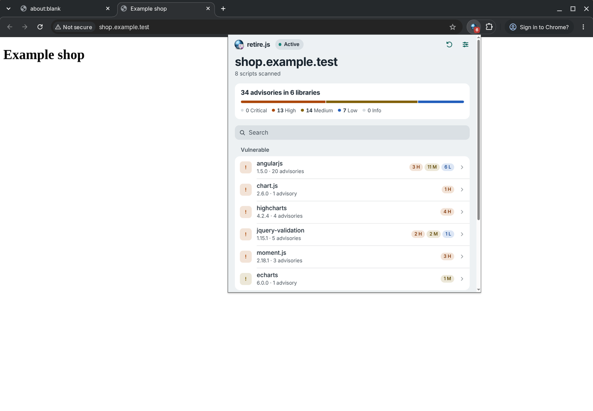
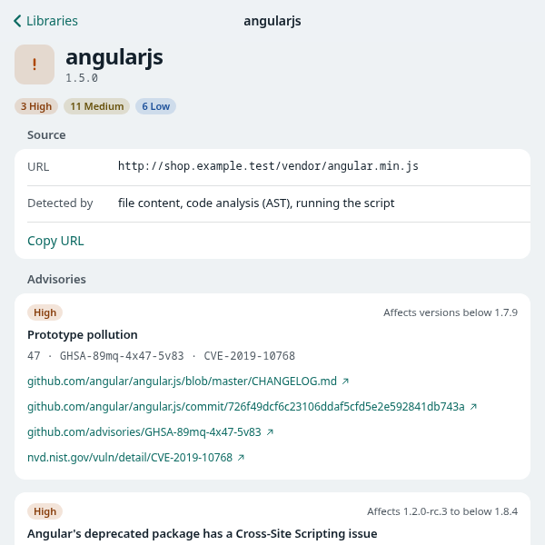

# Browser extensions

## Install without Node.js

Download this repository using **Code → Download ZIP** on GitHub and extract it, or clone it. Complete prebuilt packages are included:

- `chrome/extension`: Chrome 116+, with sandboxed function detection.
- `chrome/extension-no-func`: Chrome 116+, static and AST detection only.
- `dist/firefox`: Firefox 140+, static and AST detection only.

In Chrome, open `chrome://extensions`, enable Developer mode, and **Load unpacked** from the appropriate extracted Chrome directory. For Firefox, see [the Firefox instructions](../firefox/README.md). No Node.js installation or build is needed to load these packages.

All three packages bundle the advisory repository, so they can scan from the first launch without internet access or access to GitHub. When available, repository updates are downloaded and saved locally. If an update fails, scanning continues with saved or bundled data, which may be older, and the popup shows an update warning.

## Development

Use Node.js 24 LTS and npm. Run `build_chrome.bat` on Windows or `./build_chrome.sh` on Unix from the repository root. The build compiles the scanner and creates all three packages without relying on symlinks. Reload the extension and test page after rebuilding. Include updated prebuilt packages when committing changes to their sources; CI checks that the packages match the build.

The popup is shared source in `chrome/build/extension/popup.html`, `popup.css`, and `js/popup.js`. The shared background runtime is `js/runtime.js`. `chrome/build/build.js` bundles that runtime with the scanner and copies the UI and browser-specific manifest into each package. Chrome manifest sources are in `chrome/build/extension/manifest.json` and `chrome/build/extension-no-func/manifest.json`. Edit sources under `chrome/build` and rebuild; the original installation directories remain ready to load after `git pull`.

Scanning observes new HTTP(S) script requests. Switching to a tab, or opening the popup on one, that the background did not watch load (for example after an extension reload or after the browser stopped the idle background) waits 3 seconds, reads the page's script URLs and scans them. Refresh discards the tab's results and scans the scripts seen since the last navigation plus those on the page again, without reloading. Scan pages and Deep scan default to on; settings persist across browser restarts. Disabling scanning retains results. The badge counts unique vulnerable library occurrences (URL, component, version); The severity summary counts advisory occurrences across those libraries; row pills show nonzero counts by severity (C/H/M/L/I, or U for unrated). Search and Show unknown do not change totals or exported data. Results are held only in background memory and reset on top-level navigation or a background restart.

Results and pending requests are not saved to storage. Closing a tab removes both from memory. Settings and advisory repository updates remain saved locally. Scripts served from the browser's in-memory cache may be invisible to `webRequest`; use a hard reload or disable caching in DevTools when checking a page.

The standard Chrome package executes downloaded JavaScript in an isolated sandbox to detect versions. Use Chrome no-func or Firefox if that behavior is unwanted. Static scanning and AST analysis do not execute downloaded scripts.

## Popup examples

The 600×600 popup follows the light or dark system appearance. It opens on a summary of the page: advisories by severity, a search field, and libraries grouped into vulnerable, no known findings, scanning, and other scripts. Unidentified scripts and failed scans are listed by file name. Select a library to open its details: the script URL with Copy URL, how it was detected, and each advisory with its affected range and references. Go back with the Libraries button, Alt+Left, or by dragging from the left edge. The options button opens a sheet with Scan pages, Deep scan, Show unidentified scripts, and Export Results as JSON, which includes the complete snapshot even when the list is filtered. Settings persist between sessions.

Here, "popup" means the extension window opened by clicking retire.js in the browser's toolbar or Extensions menu. This redesign changes that window; it does not inject an overlay or other content into the web page.

These screenshots show the actual Chrome 156 popup, captured on November 3, 2026, on a local example page that loads real builds of AngularJS 1.5.0, Chart.js 2.6.0 (which bundles moment.js 2.18.1), Highcharts 4.2.4, jQuery Validation 1.15.1, ECharts 6.0.0 and Bootstrap 5.0.0, plus one unidentified script and one that fails to load. These are version matches, not exploit confirmations. Firefox uses the same UI and is tested separately.





[docs/images/popup](../docs/images/popup/) has every popup screen in light and dark: the library list, library details and advisories, search, the options sheet, unidentified scripts, scanning disabled, a rescan in progress, and an unsupported page.

## Checks

After compiling Node sources, run `npm test` in `chrome/build` for the extension regression tests. Run `npm run build` there to rebuild the three packages. The repository Node tests and validation tools are unchanged in scope.

Native browser smoke checks are also available from the repository root with Node.js 22 or newer. They use the default Windows install locations of Chrome and Firefox; set `CHROME_PATH` or `FIREFOX_PATH` to use another browser binary, for example `CHROME_PATH=/usr/bin/google-chrome-stable` on Linux:

```text
node chrome/test/browser-smoke.cjs chrome
node chrome/test/browser-smoke.cjs chrome-no-func
node chrome/test/browser-firefox-smoke.cjs
```

These checks launch hidden headless browsers with isolated profiles, serve local test pages, and save screenshots and test exports under ignored `tmp/browser-smoke/`. Run them sequentially because they share a local fixture port. They do not access your normal browser profiles. CI runs the unit checks and builds on Windows and Ubuntu; native browser checks are separate.
